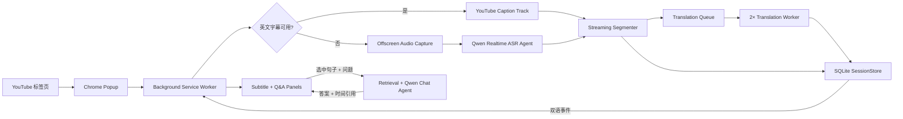

# Real-time AI Video Companion 阶段性交接文档

> 文档日期：2026-08-06  
> 项目阶段：MVP 阶段性结束，可本地运行，暂未进入公开发布与规模化验证  
> 文档用途：项目复盘、简历复查、面试准备、后续技术接手  
> 维护原则：只记录可验证事实；未采集的数据不得包装为项目成果

---

# 第一部分：产品复盘与简历证据

## 1. 项目摘要

Real-time AI Video Companion 是一款面向英语听力不足用户的 Chrome 插件。它捕获 YouTube 当前标签页的音频，通过千问实时 ASR 生成英文转写，结合上下文完成中文翻译，并在可移动的侧边面板中保存双语记录。用户还可以选中不理解的英文句子，向 AI 询问含义、语法和视频上下文。

项目不是单次 Prompt 或聊天机器人 Demo，而是一条可运行的 AI 工作流：

```text
用户播放 YouTube 视频
  → 插件捕获并保留原始声音
  → 实时上传音频流
  → ASR 生成增量英文
  → 智能断句形成稳定片段
  → 翻译 Agent 异步生成中文
  → 双语记录回填并自动跟随
  → 用户选择句子发起上下文问答
```

## 2. 产品初衷与问题定义

### 2.1 目标用户

- 能阅读部分英文，但难以跟上英语母语视频语速的学习者；
- 需要观看 YouTube 英文课程、访谈、科技测评或知识内容的用户；
- 希望在不中断视频的情况下理解内容，并能继续追问长难句的用户。

### 2.2 核心用户任务（JTBD）

当用户观看英文 YouTube 视频时，希望在尽量不打断观看节奏的前提下获得可靠的双语理解，并能随时回看或询问不理解的句子。

### 2.3 原流程的主要断点

- 英语听力跟不上时，需要暂停、回放或切换到翻译工具；
- 普通字幕只能给出文本，不能解释语法和上下文；
- 强同步的 AI 翻译字幕会受到 ASR 断句和模型响应时间影响；
- 长难句可能让翻译队列阻塞，后续内容持续积压；
- 频繁出现“翻译中”和字幕跳动，会从辅助信息变成视觉干扰。

### 2.4 为什么适合使用 AI

- 输入是连续、非结构化的自然语音，传统规则无法完成开放式语音识别；
- 翻译需要结合上下文和专业术语，逐词映射难以保证语义自然；
- 用户追问具有开放性，需要理解选中句子和近期视频内容；
- 错误结果不会自动触发资金、权限或其他高风险动作，用户可以结合英文原文自行判断，适合作为低风险 Copilot。

## 3. 产品演进时间线

### 阶段一：底部实时双语字幕

最初方案是在视频下方显示英文原文和中文翻译，目标是尽量接近传统字幕体验。

暴露的问题：

- ASR 需要等待语音结束或语义相对稳定后才能输出完整句子；
- 翻译需要额外网络请求，不可能与英文完全同时出现；
- 过早翻译会生成半句、重复句或语义不稳定的中文；
- 长句处理时间较长，容易阻塞后续字幕；
- “翻译中”反复出现，明显干扰视频观看。

### 阶段二：本地 ASR 与云端翻译尝试

项目曾尝试本地 Whisper 与 DeepSeek 翻译组合，以减少对单一云服务的依赖。

主要结论：

- 本地模型受电脑算力影响，难以稳定达到接近零延迟；
- DeepSeek 可以承担文本翻译与问答，但不能直接替代实时语音识别链路；
- 多供应商组合增加了配置、排障和模型行为不一致的成本。

产品决策：当前 MVP 统一使用千问实时 ASR、翻译和聊天模型，优先保证链路一致性和可维护性。

### 阶段三：从“字幕”转为“视频理解伴侣”

核心判断从“怎样让中文字幕瞬间出现”转为“怎样减少延迟对用户理解的伤害”。

因此进行了产品形态重构：

- 由视频底部字幕改为右侧双语记录面板；
- 英文实时内容优先出现，中文完成后原位回填；
- 取消持续出现的“翻译中”视觉状态；
- 双语记录可以回看，不要求与视频逐帧同步；
- 增加基于选中句子和上下文的视频问答；
- 面板支持拖动、折叠、设置和位置保存，减少画面占用。

### 阶段四：稳定性和交互细节迭代

- 解决 `tabCapture` 接管音频后视频没有声音的问题；
- 增加内容脚本探测、自动注入和消息重试；
- 启动失败时回滚音频捕获、WebSocket 和后端会话；
- 优化自动滚动：用户主动查看历史内容时不强制拉回底部；
- 增加“回到最新”按钮和多次布局稳定后的滚动校正；
- 排查并解决受限后端进程无法访问千问 WebSocket 的 `WinError 5`。

## 4. 关键产品决策与取舍

| 决策 | 放弃或限制的方案 | 判断依据 | 当前结果 |
|---|---|---|---|
| 从强同步字幕转为双语记录面板 | 持续追求接近零延迟的中文字幕 | 翻译延迟无法完全消除，等待状态严重干扰观看 | 英文可先读，中文异步回填，历史内容可回看 |
| 使用流式智能断句 | 每个 ASR 增量都立即翻译 | 半句翻译不稳定，调用次数与成本更高 | 按标点、词数、最终状态和最长等待切分 |
| 使用两个翻译 Worker | 单线程严格串行翻译 | 长句会阻塞后续内容 | 多片段可并发处理，并按记录 ID 回填 |
| 当前统一使用千问 | 本地 Whisper + DeepSeek / 多供应商组合 | 本地延迟受硬件影响，多供应商排障复杂 | ASR、翻译、问答使用统一云服务链路 |
| AI 作为理解 Copilot | 自动判断用户是否已理解、自动执行高风险动作 | 结果有概率性，用户需要控制阅读和追问 | AI 提供转写、翻译和解释，用户决定是否采信 |
| 会话暂存内存 | 第一版直接引入数据库和账号体系 | 当前目标是验证实时理解闭环，而非长期知识库 | 部署简单，但重启后记录丢失 |

## 5. AI 产品经理能力证据

| 能力 | 项目中的具体证据 | 可被追问的材料 |
|---|---|---|
| 问题定义 | 将“做实时字幕”重构为“降低英文视频理解成本” | 产品形态从底部字幕转向视频理解伴侣 |
| AI 适配判断 | 区分 ASR、翻译、问答适合 AI 的部分，并限制 AI 只做低风险辅助 | 三类 Agent 职责和完整数据流 |
| 工作流设计 | 设计音频捕获、ASR、断句、翻译队列、记录回填和上下文问答闭环 | `main.py`、`agents.py`、`background.ts` |
| 概率性管理 | 不直接翻译每个增量结果，通过稳定片段降低错误和重复 | `StreamingSegmenter` 及对应单元测试 |
| 产品取舍 | 在质量、延迟、成本和视觉干扰之间选择英文优先、中文异步回填 | 迭代过程和双语记录面板 |
| 异常与可恢复性 | 增加启动失败回滚、内容脚本重试、暂停恢复和错误状态 | `background.ts` 与前端状态处理 |
| 技术理解与协同 | 独立实现 React/TypeScript 插件、FastAPI 后端和千问接口 | 可运行源码、构建产物和测试 |
| 反馈迭代 | 根据实际使用中出现的静音、延迟、滚动和连接问题修改机制 | 故障记录与最终交互方案 |

## 6. 可量化验证与证据等级

### 6.1 已验证事实

| 事实 | 证据 | 等级 |
|---|---|---|
| 后端关键逻辑具备自动化测试 | 45 项 Python 单元测试通过 | 已验证 |
| 前端源码可通过类型检查并生成生产构建 | `tsc --noEmit` 与 Vite build 成功 | 已验证 |
| 后端能够连接千问实时 ASR | WebSocket 握手收到 `session.ready` | 已验证 |
| 后端健康检查可报告模型配置状态 | `/api/health` 返回 ASR、翻译和模型配置 | 已验证 |
| 视频原声可与音频识别并存 | Offscreen 音频链路将源音频连接回输出端 | 代码实现并人工实测 |
| 自动跟随在用户上滚时可暂停 | 上滚、搜索、选中句子后停止抢回底部 | 代码实现并人工实测 |
| 可直接加载 Chrome 插件 | `extension/dist` 包含完整 Manifest V3 构建产物 | 已验证 |

### 6.2 已观察但未形成统计的数据

- 相比最初字幕方案，侧边记录面板主观干扰更低；
- 双 Worker 能减少长句对后续翻译的阻塞；
- 英文先显示、中文回填能降低用户对翻译等待的感知；
- 自动注入与重试降低了扩展重载后的通信失败。

以上结论来自开发者实测，没有对照实验、用户样本量或统计显著性，简历中不应写成百分比提升。

### 6.3 尚未验证

- ASR 字错率、翻译准确率和专业术语一致率；
- 端到端 P50、P95 延迟及不同网络环境下的稳定性；
- 单小时视频的模型调用成本；
- 真实用户的启动成功率、使用时长、留存率和满意度；
- AI 问答的采纳率、帮助度和幻觉率；
- 长视频、多说话人、噪声和不同口音下的效果。

## 7. 简历复查指南

### 7.1 可直接使用的项目经历

**Real-time AI Video Companion｜AI 产品经理 / 独立开发**

- 聚焦英语听力用户观看 YouTube 时字幕滞后、长句难理解和跨工具查询的问题，独立完成需求定义、产品设计、Agent 架构及全栈 MVP 落地。
- 设计“实时语音识别—智能断句—上下文翻译—视频问答”工作流，拆分 ASR、Translation、Context Management 三类能力，并通过异步队列与双 Worker 平衡质量和延迟。
- 根据实测将频繁跳动的底部字幕重构为可移动双语记录与 AI 问答面板，实现英文优先、中文异步回填、历史回看和选句追问。
- 建立异常回滚、内容脚本重试、会话持久化与自动化测试，解决音频捕获静音、长句阻塞、滚动跟随和云端连接等问题；完成 45 项后端测试、真实千问端到端测试及前端生产构建验证。

### 7.2 面试时应讲清的个人贡献

- 定义目标用户、核心问题和 MVP 边界；
- 做出从“实时字幕”到“视频理解伴侣”的产品决策；
- 设计 Agent 分工、上下文流和异常路径；
- 独立完成前端、扩展、后端和模型服务集成；
- 根据真实失败修改产品机制，而不是简单归因于“模型不够好”；
- 定义当前可以验证的工程指标，并承认尚未完成用户和商业验证。

### 7.3 不应写入简历的内容

除非未来补充真实数据，否则不要写：

- “翻译准确率达到 95%”；
- “延迟降低 80%”；
- “服务数千名用户”；
- “显著提升学习效率或留存”；
- “实现零延迟翻译”；
- “已经商业化”或“达到生产级稳定性”。

### 7.4 面试高频追问与回答方向

**为什么必须使用 AI？**  
语音识别、上下文翻译和开放式问答都依赖非结构化语言理解，规则无法覆盖；AI 只承担可逆的理解辅助，不执行高风险动作。

**为什么不继续追求零延迟字幕？**  
完整翻译依赖稳定语义和云端请求，物理上存在延迟。继续压缩等待会牺牲语义完整性并增加视觉跳动，因此改为英文优先、中文异步回填。

**为什么选择三个 Agent？**  
ASR、翻译和问答的输入、状态与失败方式不同。独立职责便于替换模型、控制上下文、隔离异常和分别评测。

**这个项目最大的失败是什么？**  
早期把“实时”理解成中文字幕必须与语音同步，过度围绕字幕形态优化。实测后才意识到用户目标是理解视频，而不是观看一条技术上完美的字幕流。

**如果重来一次，最先验证什么？**  
先用低成本原型验证用户更偏好底部字幕还是侧边记录，并建立一组真实视频样本测量端到端延迟、翻译可读性和用户中断次数，再决定架构投入。

## 8. 阶段复盘

### 做对的事情

- 没有把模型能力等同于用户价值，最终重构了产品形态；
- 保留英文原文，使用户可以判断中文是否可信；
- 把 ASR、翻译、聊天和记录管理拆成相对清晰的模块；
- 对静音、滚动、脚本失联和网络权限等端到端问题进行真实排障；
- 没有为简历虚构用户指标和模型准确率。

### 可以更早做的事情

- 在开发底部字幕前先做可点击原型或 Wizard-of-Oz 测试；
- 更早定义端到端延迟、翻译可读性和任务成功标准；
- 从第一版就记录 ASR、翻译、排队和渲染各阶段时间；
- 更早用不同语速、口音、噪声和专业领域视频建立评测集；
- 在模型切换前先用统一样本比较质量、延迟、成本和运维复杂度。

### “超越复盘”的下一步

要让项目从“完整个人 MVP”升级为更有说服力的 AI 产品案例，重点不应继续增加功能，而应补齐证据闭环：

1. 招募 5–10 名目标用户完成固定观看任务；
2. 建立 20–50 段代表性视频评测集；
3. 记录英文首字延迟、稳定片段延迟、中文回填延迟和失败率；
4. 记录用户回放次数、选句追问率、回到最新次数和任务完成情况；
5. 对失败样本按 ASR、断句、翻译、网络、交互和用户预期分类；
6. 用数据决定下一轮优化对象，而不是继续堆叠模型或功能。

---

# 第二部分：技术交接

## 9. 当前系统架构



## 10. 组件职责

### Chrome 插件

| 文件 | 职责 | 主要修改场景 |
|---|---|---|
| `extension/src/popup/main.tsx` | 启动、暂停、恢复、结束及显示设置 | 修改插件弹窗交互 |
| `extension/src/background.ts` | 创建后端会话、维护 WebSocket、协调音频和页面消息 | 修改会话协议、重连和状态机 |
| `extension/src/offscreen.ts` | 获取标签页音频、保留原声、降采样并生成 PCM | 修改音频格式、帧大小和静音行为 |
| `extension/src/content.ts` | 注入双语记录、聊天、拖动、搜索和自动滚动面板 | 修改 YouTube 页面内体验 |
| `extension/src/types.ts` | 前端共享类型 | 修改消息和设置字段 |
| `extension/manifest.json` | 权限、内容脚本、Service Worker 和 host 权限 | 修改扩展权限及加载入口 |
| `extension/dist/` | Chrome 实际加载的生产构建 | 源码变化后重新构建 |

### FastAPI 后端

| 文件 | 职责 | 主要修改场景 |
|---|---|---|
| `backend/app/main.py` | REST、WebSocket、队列、Worker 和会话生命周期 | 修改整体工作流和事件协议 |
| `backend/app/config.py` | 环境变量及默认参数 | 新增模型或性能配置 |
| `backend/app/services/agents.py` | 千问 ASR、翻译和聊天接口 | 切换模型、Prompt 或协议 |
| `backend/app/services/segmenter.py` | 流式增量文本切分 | 优化延迟与语义完整性 |
| `backend/app/services/session_store.py` | 内存会话、SQLite 持久化、相关片段检索和阶段摘要 | 修改历史或上下文策略 |
| `backend/app/models.py` | Pydantic 请求和记录模型 | 调整 API 数据结构 |
| `backend/tests/` | ASR 解析、断句和会话测试 | 回归验证与新增边缘样本 |

## 11. 数据流与事件协议

### REST 接口

| 方法 | 路径 | 用途 |
|---|---|---|
| `GET` | `/api/health` | 查看后端、ASR、翻译和模型配置状态 |
| `POST` | `/api/sessions` | 创建一次视频理解会话 |
| `GET` | `/api/sessions/{session_id}` | 获取当前会话和双语记录 |
| `DELETE` | `/api/sessions/{session_id}` | 删除会话 |
| `GET` | `/api/history` | 获取本地历史会话列表 |
| `GET` | `/api/history/{session_id}` | 获取历史字幕、摘要与问答详情 |

### 浏览器发往后端的 WebSocket 消息

| 类型 | 关键字段 | 用途 |
|---|---|---|
| `audio.append` | `audio` | 追加 Base64 PCM 音频 |
| `playback.position` | `seconds` | 同步当前视频位置，用于 ASR 时间轴 |
| `caption.segment` | `text`、`start_ms`、`end_ms`、`source` | 发送 YouTube 字幕片段 |
| `chat.ask` | `request_id`、`question`、选中句子 | 发起视频上下文问答 |
| `session.close` | 无 | 结束会话 |

### 后端发往浏览器的事件

| 类型 | 用途 |
|---|---|
| `session.ready` | ASR 连接就绪，浏览器可开始上传音频 |
| `transcript.live` | 实时增量英文 |
| `transcript.segment` | 已形成稳定片段，中文尚未回填 |
| `transcript.translation` | 对应记录的中文翻译完成 |
| `transcript.translation_error` | 某条翻译失败，但会话继续 |
| `chat.answer` | AI 问答成功 |
| `chat.error` | AI 问答失败 |
| `session.summary` | 一批字幕的阶段摘要完成 |
| `error` | 会话级错误 |

## 12. 本地部署与启动

### 12.1 环境要求

- Windows 10/11；
- Chrome 116+；
- Python 3.10+；
- Node.js 18+（修改前端时需要）；
- 已开通千问实时 ASR 的阿里云百炼账号。

### 12.2 后端初始化

```powershell
cd backend
python -m venv .venv
.\.venv\Scripts\python.exe -m pip install -r requirements.txt
Copy-Item .env.example .env
notepad .env
```

在 `.env` 中填写 `DASHSCOPE_API_KEY`，然后启动：

```powershell
.\.venv\Scripts\python.exe -m uvicorn app.main:app --port 8000
```

访问：

```text
http://127.0.0.1:8000/api/health
```

预期至少包含：

```json
{
  "ok": true,
  "asr_configured": true,
  "translation_configured": true
}
```

### 12.3 插件构建

仓库中的 `extension/dist` 可直接加载。如修改源码：

```powershell
cd extension
npm install
npm run build
```

然后进入 `chrome://extensions`，打开开发者模式，加载或重新加载 `extension/dist`。

## 13. 配置与密钥交接

### 13.1 当前环境变量

| 变量 | 是否敏感 | 用途 |
|---|---|---|
| `DASHSCOPE_API_KEY` | 是 | 千问实时 ASR、翻译和问答鉴权 |
| `QWEN_ASR_WS_URL` | 否 | 实时 ASR WebSocket 地址 |
| `QWEN_ASR_MODEL` | 否 | ASR 模型名 |
| `QWEN_ASR_LANGUAGE` | 否 | 输入语言 |
| `QWEN_ASR_SAMPLE_RATE` | 否 | 音频采样率 |
| `QWEN_VAD_SILENCE_MS` | 否 | VAD 静音判定时间 |
| `QWEN_TRANSLATION_BASE_URL` | 否 | 翻译 API 地址 |
| `QWEN_TRANSLATION_MODEL` | 否 | 翻译模型名 |
| `QWEN_TRANSLATION_TIMEOUT_SECONDS` | 否 | 翻译超时 |
| `QWEN_CHAT_MODEL` | 否 | 视频问答模型名 |
| `TRANSLATION_WORKERS` | 否 | 翻译 Worker 数量 |
| `SEGMENT_MIN_WORDS` | 否 | 最少切分词数 |
| `SEGMENT_MAX_WORDS` | 否 | 最大切分词数 |
| `SEGMENT_MAX_WAIT_SECONDS` | 否 | 最长切分等待 |
| `SESSION_MAX_SEGMENTS` | 否 | 单会话记录上限 |
| `BACKEND_CORS_ORIGINS` | 否 | 允许访问后端的来源 |

### 13.2 密钥管理规则

- 真实密钥只保存在 `backend/.env`；
- `.env` 已被 `.gitignore` 排除，不得复制到 README、Issue、截图或聊天中；
- GitHub 只保存无密钥的 `backend/.env.example`；
- 旧版 OpenAI、DeepSeek 密钥当前不参与运行，建议从本地 `.env` 删除并在对应控制台停用；
- 若怀疑密钥出现在终端截图、聊天或提交历史中，应立即在云平台轮换；
- 后续云端部署应使用平台 Secret Manager，不应把密钥写入镜像或前端。

## 14. 数据库与数据生命周期

### 当前状态

项目使用本地 SQLite。默认数据库位于后端运行目录的 `data/video_companion.db`；EXE 版本位于 `release/VideoCompanionBackend/data/video_companion.db`。保存会话、字幕、阶段摘要和问答，插件弹窗可查看历史详情。

### 影响

- 重启后端后历史记录仍保留；
- 当前是单机数据库，不支持账号、跨设备同步和多人协作；
- 问答检索覆盖阶段摘要、相关历史片段与近期字幕；
- 当前没有数据库容量管理和用户主动删除历史的入口；
- 需要云端多人服务时，应迁移 PostgreSQL 并补齐鉴权、租户隔离和数据删除。

### 后续持久化建议

- MVP 用户验证前：保持内存存储，避免过早引入账号系统；
- 需要导出记录时：优先增加本地 JSON/SRT 导出；
- 需要跨会话历史时：引入 SQLite 作为单机方案；
- 需要多人云服务时：使用 PostgreSQL，并增加用户、会话、片段、问答和模型调用审计表；
- 任何持久化上线前都应增加数据删除、保存期限和隐私告知。

## 15. 测试与验收

### 后端测试

```powershell
cd backend
.\.venv\Scripts\python.exe -m unittest discover -s tests -v
```

当前共有 45 项测试，覆盖：

- 千问不同 ASR 事件格式解析；
- 增量文本空格保留；
- 标点触发切分；
- 最大词数防止长句阻塞；
- 最长等待触发切分；
- 最终短尾刷新和状态重置；
- 双语记录原位更新；
- 最近上下文组装。
- 旧片段相关性检索和时间引用；
- SQLite 会话、字幕、摘要和问答持久化；
- EXE 启动、单实例、Key 长度与密钥脱敏。

### 前端构建

```powershell
cd extension
npm.cmd run build
```

构建命令同时运行 TypeScript 类型检查和 Vite 生产构建。

### 人工验收清单

- 后端健康页显示 ASR 和翻译已配置；
- 打开英文视频后能够听到原声；
- 英文增量可以实时出现；
- 中文完成后回填到正确英文记录；
- 长句不会无限阻塞后续内容；
- 暂停识别不会让视频静音；
- 面板可以拖动、折叠并保存位置；
- 用户上滚后不会被新内容强制拉到底部；
- “回到最新”可以恢复自动跟随；
- 选中句子后能够发起上下文问答；
- YouTube 有英文字幕时优先走字幕源，无字幕时自动回退 ASR；
- 点击字幕时间或 AI 时间引用可以跳转视频；
- 插件弹窗可以查看历史字幕和问答；
- 结束会话后音频、WebSocket 和后端 Session 被清理。

## 16. 常见故障手册

| 症状 | 常见根因 | 检查与处理 |
|---|---|---|
| `无法连接本地后端` | FastAPI 未运行或端口不一致 | 打开健康检查；重新运行 Uvicorn；确认端口为 8000 |
| `[WinError 5] 拒绝访问` | 后端进程在受限环境启动，无法连接千问 WebSocket | 结束旧后端，用具有正常网络权限的 PowerShell 启动；用 `session.ready` 验证握手 |
| `Receiving end does not exist` | 扩展重载后旧页面缺少有效内容脚本 | 重新加载扩展并刷新 YouTube；确认自动注入逻辑生效 |
| 捕获后视频无声 | `tabCapture` 接管音频但未回接输出 | 检查 Offscreen 音频节点是否连接 `audioContext.destination` |
| 中文长时间不出现 | 翻译请求超时、Key/模型错误或队列积压 | 查看后端日志、健康页、模型权限和翻译超时配置 |
| 长句卡住 | 断句阈值过大或 ASR 未发送 final | 检查 `SEGMENT_MAX_WORDS` 与 `SEGMENT_MAX_WAIT_SECONDS` |
| 自动滚动停在旧位置 | 用户上滚/搜索/选句后自动跟随被暂停 | 点击“回到最新”；检查底部距离判断和布局稳定定时器 |
| `model not found` | 模型名或百炼地域端点不匹配 | 以账号控制台可用模型和地域地址为准修改 `.env` |
| 问答不可用 | 会话已经结束或 WebSocket 断开 | 保持会话处于运行或暂停；查看 `chat.error` 事件 |

## 17. 已知风险与技术债务

### 产品与评测

- 没有真实目标用户样本和持续反馈机制；
- 没有建立翻译质量、问答帮助度和端到端延迟基线；
- 当前设置项偏工程参数，尚未验证用户是否理解；
- 侧边面板仍会占用页面空间，尚未对不同屏幕尺寸做大样本验证。

### 工程与运维

- 已提供当前用户级一键安装器、桌面/开始菜单快捷方式和可选开机启动；尚未实现托盘常驻、代码签名和自动更新；
- SQLite 支持单机持久化，但不支持多实例并发或跨设备同步；
- 云端调用缺少统一重试、指数退避、熔断和速率限制；
- 日志不是结构化日志，缺少请求链路 ID 和延迟分段指标；
- `ScriptProcessorNode` 属于旧式 Web Audio API，后续可迁移到 AudioWorklet；
- `dist` 被提交到仓库，存在源码修改后忘记重新构建的漂移风险；
- 自动化测试主要集中在后端单元逻辑，缺少浏览器端 E2E 和真实音频回归测试；
- 旧版 DeepSeek 和本地 ASR 说明文件仍保留，后续可归档到 `docs/history/`，避免新维护者误用。

### 安全与隐私

- 音频和文本会发送到第三方云模型服务，正式发布前必须提供清晰告知；
- 本地后端没有用户鉴权，设计前提是只监听 `127.0.0.1`；
- Chrome 扩展权限应继续遵守最小化原则；
- 若改为云端部署，必须增加鉴权、租户隔离、审计、加密、限流和数据删除机制；
- AI 翻译和问答可能出现错误，界面应始终保留英文原文并避免宣称绝对准确。

## 18. 下一阶段路线图

### P0：形成可重复验证的产品证据

1. 建立包含不同口音、语速、噪声和专业领域的评测集；
2. 增加 ASR、断句、翻译和渲染的分阶段延迟埋点；
3. 招募少量目标用户进行任务测试；
4. 建立失败样本分类和人工评分 Rubric；
5. 明确最小可接受质量与延迟门槛。

### P1：提升可用性和可恢复性

1. 将现有最小化启动升级为托盘常驻，并补充安装包代码签名；
2. 增加连接状态、重试进度和可理解的错误引导；
3. 增加双语记录导出；
4. 增加术语表和视频主题提示；
5. 完成浏览器端 E2E 测试和真实音频回归。

### P2：数据与个性化

1. 增加历史记录删除、导出和保存期限；
2. 支持历史会话搜索和学习笔记；
3. 支持用户纠正翻译并回流评测集；
4. 支持多语言输入、翻译目标和个性化难度解释。

### P3：规模化前置条件

只有在真实用户价值被验证后再考虑：

- 云端托管和账号系统；
- 订阅或按使用量计费；
- 模型路由和成本优化；
- 隐私政策、数据治理和合规；
- Chrome Web Store 正式发布与自动更新。

## 19. 阶段性交接清单

| 项目 | 状态 | 说明 |
|---|---|---|
| Chrome 插件源码 | 完成 | React + TypeScript + Manifest V3 |
| FastAPI 后端 | 完成 | 支持会话、实时 WebSocket、翻译和问答 |
| 千问实时 ASR | 完成 | 已验证 `session.ready` 握手 |
| 千问翻译与聊天 | 完成 | 使用统一 DashScope API Key |
| 流式断句 | 完成 | 有单元测试覆盖 |
| 双语记录面板 | 完成 | 横向字幕与纵向问答可独立拖动、缩放、隐藏和记忆布局 |
| 视频问答 | 完成 | 支持选句、相关片段检索、阶段摘要和时间引用 |
| 生产构建 | 完成 | `extension/dist` 可加载 |
| 后端自动化测试 | 完成 | 45 项通过，并完成一次真实千问端到端冒烟测试 |
| Windows EXE | 完成 | 双击后自动启动服务，保留本机 Key 配置 |
| Windows 一键安装器 | 完成 | 当前用户安装、快捷方式、卸载、升级保留数据和可选开机启动 |
| 持久化数据库 | 完成 | SQLite 保存会话、字幕、摘要和问答，插件可回看 |
| 用户研究与量化评测 | 未开始 | 下一阶段最高优先级 |
| 云端部署与商业化 | 未开始 | 应在用户价值验证后考虑 |

## 20. 最终交接结论

该项目已经完成从用户问题、AI 工作流、交互原型到可运行全栈 MVP 的闭环，能够证明独立定义问题、设计 Agent 系统、处理模型不确定性和完成工程落地的能力。

当前最重要的不足不是功能数量，而是缺少真实用户、评测集、线上指标和单位成本数据。未来继续推进时，应优先建立“样本—指标—失败归因—迭代”的证据闭环，而不是直接增加更多模型或功能。

在简历和面试中，应将本项目定位为：**完成产品重构和技术闭环、具备明确工程验证，但尚未进入规模化用户验证的个人 AI 产品 MVP。**
