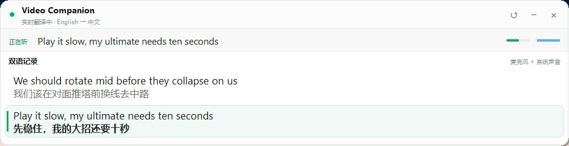
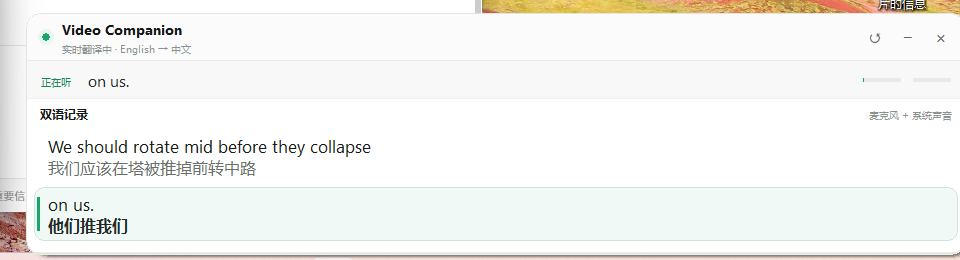
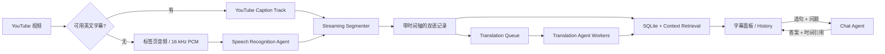

# Real-time AI Video Companion

> 面向英语听力学习者的 YouTube 实时双语理解与上下文问答 Chrome 插件；并额外提供面向跨境直播的本机音频实时翻译模式。

Real-time AI Video Companion 会优先读取 YouTube 自带英文字幕，以更低延迟获得准确时间轴；视频没有可用英文字幕时，自动切换到千问实时语音识别。系统结合上下文生成中文翻译，用户还可以选中不理解的句子，直接向 AI 询问含义、语法和整段视频上下文。

当前版本是一个可本地运行的 MVP：Chrome 插件负责音频捕获和交互，FastAPI 后端负责会话管理、实时 ASR、翻译与问答。OpenAI、DeepSeek 和本地 Whisper 均不参与当前运行链路。

## 2026-11 更新：跨境直播模式（Live Mode）

除了看 YouTube 视频，同一个工具现在也能用于跨境直播：想直播海外游戏，但队友基本都讲英文，国内观众听不懂，主播只能一边打一边停下来解释。跨境直播模式不再采集 Chrome 标签页，而是直接采集**本机麦克风与系统声音**（WASAPI loopback），把英文语音实时翻译成中文，并用**和插件同款的白卡片悬浮窗**显示在桌面上。



这块浮层是独立的 Win32 原生窗口，不是网页，也不是浏览器里的字幕叠层；直播时可以在 OBS 里只把这一块叠加到画面上（显示器采集 / 窗口采集），不必把整个桌面给观众看。观众能同步理解主播和队友的沟通，主播不用随时停下来解释。



- 桌面主窗口新增 **「▶ 开启跨境直播模式」** 按钮，以及麦克风 / 系统声音 / 悬浮窗三个开关和实时输入电平；
- 复用原有的千问 ASR + 上下文翻译 + Agent 问答链路，新增 `backend/app/live/`（PCM 处理、设备枚举、断句与字幕状态机、事件总线、HTTP / WebSocket 路由）与 `backend/launcher/caption_overlay.py`（原生分层窗口）；
- 悬浮窗可拖动、收起，右键可切换深色字幕条 / 色键黑底、调整字号、显隐英文，样式与第一版插件保持一致；
- 主播本机另有控制台（Agent 问答、状态查看）、SRT 字幕导出与 `/api/live/status` 状态端点，仅用于主播端，不给观众展示。

架构说明、实测数据与已知边界见 **[LIVE_MODE.md](LIVE_MODE.md)**。

## 为什么做这个项目

传统双语字幕通常只能解决“看见翻译”的问题，却难以同时兼顾实时性、长句理解和后续追问。项目早期采用视频底部字幕方案，但实测发现云端翻译存在不可避免的延迟，频繁出现的等待状态和字幕跳动会干扰观看；长难句还可能阻塞后续内容。

因此，产品从“强同步字幕”调整为“视频理解伴侣”：

- 实时英文优先展示，降低等待感；
- 中文翻译完成后回填到对应记录，不阻塞后续英文；
- 双语内容沉淀在可回看的侧边面板，而不是持续遮挡视频；
- 用户可以针对具体句子发起上下文问答，把被动阅读升级为主动理解。

## 核心能力

- **实时语音识别**：捕获当前 Chrome 标签页音频，转换为 16 kHz PCM 流并发送给千问实时 ASR。
- **双源自动切换**：优先使用 YouTube 人工/自动英文字幕；没有可用字幕时自动回退到千问实时 ASR。
- **准确视频时间轴**：字幕记录和 AI 答案都可引用视频时间，点击时间即可跳回对应画面。
- **上下文翻译**：结合最近的双语记录翻译英文片段，尽量保持术语和语义一致。
- **流式智能断句**：综合标点、最大词数、最终识别状态和最长等待时间切分文本，减少半句翻译与长句阻塞。
- **双路并发翻译**：使用异步队列和多个 Translation Worker，避免单条复杂语句阻塞后续内容。
- **视频上下文问答**：使用阶段摘要、相关片段检索和近期字幕共同回答问题，并要求答案标注证据时间点。
- **本地历史记录**：使用 SQLite 保存观看会话、双语字幕、阶段摘要和问答，可在插件弹窗中回看。
- **低干扰阅读体验**：横向字幕框与纵向问答框可独立拖动、缩放、隐藏并记忆位置，支持中英文开关、字体大小与透明度调整。
- **智能自动跟随**：默认滚动到最新记录；用户上滑、搜索或选中句子时暂停跟随，并提供“回到最新”按钮。
- **可恢复运行链路**：包含内容脚本探测、自动注入、连接重试和启动失败回滚，减少扩展重载后的通信错误。
- **保留视频原声**：音频捕获链路会把声音重新连接到浏览器输出端，暂停识别也不会让视频静音。

## 系统架构



### Agent 分工

| Agent / 模块 | 主要职责 |
|---|---|
| Speech Recognition Agent | 管理千问实时 ASR WebSocket，发送音频并解析增量及最终转写事件 |
| Translation Agent | 使用上下文翻译稳定语句，输出适合快速阅读的中文 |
| Chat Agent | 基于选中句子、相关字幕和阶段摘要回答问题，并引用视频时间 |
| Streaming Segmenter | 根据标点、词数和等待时间决定何时生成可翻译片段 |
| Session Management | 持久保存双语记录、摘要和问答，维护检索上下文并协调异步任务 |

## 技术栈

| 层级 | 技术 |
|---|---|
| Chrome 插件 | Manifest V3、Tab Capture、Offscreen Document、Chrome Storage |
| 前端 | React、TypeScript、Vite |
| 后端 | Python、FastAPI、Asyncio、WebSocket |
| AI | 千问实时 ASR、千问翻译模型、千问对话模型 |
| 本地数据 | SQLite（观看记录、字幕、摘要与问答） |
| 数据传输 | REST API、浏览器 WebSocket、Base64 PCM 音频流 |

## 项目结构

```text
backend/
  app/main.py                    FastAPI 接口、WebSocket 与任务调度
  app/config.py                  环境变量和运行参数
  app/services/agents.py         ASR、翻译和聊天 Agent
  app/services/segmenter.py      流式文本切分策略
  app/services/session_store.py  会话、双语记录与上下文管理
  tests/                         后端单元测试
  scripts/smoke_caption_flow.py  千问翻译、问答和历史端到端检查
  .env.example                   可公开的环境变量模板
  requirements.txt               Python 依赖

extension/
  src/offscreen.ts               标签页音频捕获、回放与 PCM 转换
  src/background.ts              会话控制和后端 WebSocket 通信
  src/content.ts                 YouTube 双语记录与问答面板
  src/popup/                     插件控制面板
  manifest.json                  Manifest V3 配置
  dist/                          可直接加载到 Chrome 的构建产物

release/VideoCompanionBackend/
  VideoCompanionBackend.exe      可双击启动的 Windows 后端
```

## 快速开始

### 环境要求

- Windows 10/11（当前版本主要在 Windows 上验证）
- Chrome 116 或更高版本
- Python 3.10 或更高版本
- Node.js 18 或更高版本（只有修改前端源码时才需要）
- 已开通实时语音识别模型的阿里云百炼 API Key

### 1. 下载项目

```powershell
git clone https://github.com/ninocusarch-alt/YouTube-.git
cd YouTube-
```

也可以在 GitHub 页面点击 **Code → Download ZIP**，解压后进入项目文件夹。

### 2. 一键安装（推荐，适合普通用户）

双击：

```text
release\installer\VideoCompanionSetup.exe
```

安装器不需要管理员权限，会完成以下操作：

- 安装到当前 Windows 用户的应用目录；
- 创建桌面和开始菜单快捷方式；
- 让用户选择是否开启开机自动启动；
- 安装完成后自动启动本地服务；
- 打开 Chrome 插件加载引导。

升级安装会保留本机 API Key 和历史记录。卸载入口位于 Windows“已安装的应用”和开始菜单，卸载时会明确提示将删除本地配置及历史。

### 3. 便携版或源码方式启动

不需要安装时，也可以直接双击便携版：

```text
release\VideoCompanionBackend\VideoCompanionBackend.exe
```

首次运行时粘贴千问 API Key；验证成功后服务会自动启动。以后使用时只需先双击一次 EXE，不需要输入 PowerShell 命令。

需要以源码方式开发时，才使用以下命令：

在项目文件夹中打开 PowerShell，依次执行：

```powershell
cd backend
python -m venv .venv
.\.venv\Scripts\python.exe -m pip install -r requirements.txt
Copy-Item .env.example .env
notepad .env
```

在打开的 `.env` 中填写：

```env
DASHSCOPE_API_KEY=你的千问APIKey
```

保存并关闭记事本，然后启动后端：

```powershell
.\.venv\Scripts\python.exe -m uvicorn app.main:app --port 8000
```

运行期间不要关闭这个 PowerShell 窗口。打开以下地址检查服务：

```text
http://127.0.0.1:8000/api/health
```

看到 `"ok": true`、`"asr_configured": true` 和 `"translation_configured": true`，说明后端配置成功。

### 4. 安装 Chrome 插件

1. 在 Chrome 地址栏输入 `chrome://extensions`。
2. 打开右上角的“开发者模式”。
3. 点击“加载已解压的扩展程序”。
4. 选择项目中的 `extension\dist` 文件夹。

仓库已经包含可直接使用的 `dist`。如果修改了前端源代码，需要重新构建：

```powershell
cd extension
npm install
npm run build
```

构建完成后，在 `chrome://extensions` 中点击插件的“重新加载”按钮。

### 5. 开始使用

1. 打开并播放一个 YouTube 英文视频。
2. 点击 Chrome 工具栏中的插件图标。
3. 点击“打开视频双语助手”。
4. 系统优先使用 YouTube 英文字幕，没有字幕时自动切换实时语音识别。
5. 横向字幕框显示英文和随后回填的中文；点击时间可跳转视频。
6. 点击任意字幕会打开独立问答框，可询问含义、语法或前文上下文。
7. 插件弹窗中的“查看历史记录”可回看已保存的双语记录与问答。

## 主要配置

配置文件为 `backend/.env`。以下参数均可从 `.env.example` 复制：

| 参数 | 默认值 | 说明 |
|---|---:|---|
| `QWEN_ASR_MODEL` | `qwen3-asr-flash-realtime` | 实时英文语音识别模型 |
| `QWEN_ASR_SAMPLE_RATE` | `16000` | 上传音频采样率 |
| `QWEN_VAD_SILENCE_MS` | `400` | 语音活动检测的静音阈值 |
| `QWEN_TRANSLATION_MODEL` | `qwen-plus` | 中文翻译模型 |
| `QWEN_CHAT_MODEL` | `qwen-plus` | 视频问答与阶段摘要模型 |
| `TRANSLATION_WORKERS` | `2` | 并发翻译任务数量 |
| `SEGMENT_MIN_WORDS` | `4` | 常规片段最少词数 |
| `SEGMENT_MAX_WORDS` | `18` | 强制切分的最大词数 |
| `SEGMENT_MAX_WAIT_SECONDS` | `1.6` | 无标点时的最长等待时间 |
| `SESSION_MAX_SEGMENTS` | `5000` | 单次会话最多保留的记录数 |
| `SUMMARY_BATCH_SEGMENTS` | `20` | 每多少条已翻译字幕生成一次阶段摘要 |
| `SESSION_DATABASE_PATH` | 留空 | 可选的 SQLite 保存位置；留空使用程序目录下的 `data` 文件夹 |

千问的可用模型及地域端点可能随账号和产品版本变化，请以[阿里云百炼官方文档](https://help.aliyun.com/zh/model-studio/)和账号控制台为准。

## 测试

运行后端单元测试：

```powershell
cd backend
.\.venv\Scripts\python.exe -m unittest discover -s tests -v
```

运行前端类型检查和正式构建：

```powershell
cd extension
npm run build
```

当前 45 项后端测试覆盖 ASR 事件解析、流式断句、长句防阻塞、上下文检索、SQLite 持久化、EXE 启动器、Windows 快捷方式、升级数据保留和密钥安全等关键逻辑。

## 安全与隐私

- API Key 只保存在本地后端的 `backend/.env`，不会写入扩展代码或提交到 Git。
- `.env`、Python 虚拟环境、前端依赖和缓存目录均已加入 `.gitignore`。
- 音频由本地插件发送到本地 FastAPI，再由后端连接阿里云百炼服务；使用前应了解并遵守相应平台的数据与隐私政策。
- 观看记录、字幕、摘要和问答保存在本机 SQLite 数据库中，不会写入 Chrome 插件或 Git 仓库。

## 常见问题

- **无法连接本地后端**：确认 Video Companion 主窗口仍在运行，并打开健康检查地址。
- **安装器提示程序正在运行**：先关闭 Video Companion 主窗口，再重新双击安装器。
- **Chrome 插件没有自动出现**：这是 Chrome 的安全限制；点击主程序里的“安装 / 更新 Chrome 插件”，按页面引导手动加载一次。
- **`Receiving end does not exist`**：在 `chrome://extensions` 重新加载插件，再刷新 YouTube 页面。
- **提示 API Key 未配置**：检查 `backend/.env` 中 `DASHSCOPE_API_KEY` 等号后是否有值，修改后重启后端。
- **`model not found` / `model access denied`**：当前百炼账号未开通配置的模型，请按控制台显示的模型名称修改 `.env`。
- **视频没有声音**：重新加载插件并刷新 YouTube 页面，确保使用仓库中的最新 `dist`。
- **中文比英文晚**：中文需要额外的大模型请求；系统会优先展示英文，并在翻译完成后原位回填。
- **显示“千问实时语音识别”**：代表该视频没有可读取的 YouTube 英文字幕，系统已自动使用音频识别，这是正常回退机制。
- **长句被拆成多条**：这是降低等待时间的策略，可调整 `SEGMENT_MAX_WORDS` 和 `SEGMENT_MAX_WAIT_SECONDS`。
- **AI 问答不可用**：问答仅在实时会话处于运行或暂停状态时可用。

## 当前限制与后续计划

- 当前主要针对英文视频输入和中文翻译场景。
- 默认需要先打开本地程序；用户可在主窗口一键开启或关闭“开机启动”。
- 当前安装包尚未进行商业代码签名，也没有自动更新服务。
- 翻译质量和延迟会受到网络、模型服务和视频语速影响。
- 后续可增加可观测性指标、失败样本回流、术语表、字幕导出、多语言支持和可配置模型路由。

## 项目状态

这是一个持续迭代中的个人 AI 产品与全栈工程项目，重点探索实时 ASR、上下文翻译、Agent 工作流和人机协作体验。欢迎通过 Issue 提交问题和建议。
